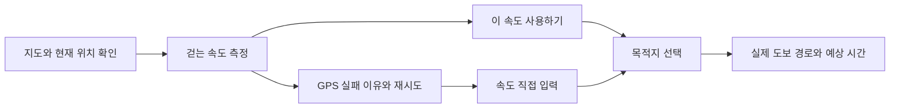

# 몇분 걸음 pace-20

2026-11-20 기준. 기존 main b00f005와 Stitch 화면을 이어서 수정했습니다.

## 바뀐 동작

| 항목 | pace-20 |
|---|---|
| 지도 시작 | 지도 연결 동의 버튼에서 GPS도 시작. 위치 확인 후 별도 측정 시작 |
| 측정 지도 | 위쪽 지도 하나 유지. 재측정 시 숨기지 않음. 화면 크기 변경 후 다시 배치 |
| 속도 적용 | 측정 중이면 GPS를 유지한 채 목적지 화면으로 이동 |
| 저장 | 측정 평균과 직접 입력 속도 모두 기기에 저장. 입력값과 측정값 구분 유지 |
| 다음 방문 | 저장 속도만 복원. GPS와 외부 지도 연결은 새로 요청 |
| 예상 시간 | 실제 경로의 남은 거리와 최근 속도로 갱신 |
| 신호 손실 | 정확한 위치를 25초 받지 못하면 기다림 종료. 재시도 또는 마지막 위치와 저장 속도를 명시적으로 선택 |
| 표본 부족 | 측정 중 2분 동안 준비되지 않으면 재측정 또는 직접 입력 안내 |
| 경로 없음 | 도보 거리와 예상 시간 미표시 |
| 끝점 차이 | 서버 경로에 직선 연결을 덧붙이지 않음. 차이가 20m 넘으면 예상 시간 보류 |
| 버튼 | 기존 흐름 배치를 유지. 고정 버튼 겹침 방지 |

## 검증 구분

| 모의 GPS 및 자동 검사 | 실제 iPhone Safari에서 확인 필요 |
|---|---|
| 측정 후 목적지와 경로로 전환 | 실제 위치 권한과 정확한 위치 허용 |
| 측정값과 수동 속도의 재방문 복원 | 개인 정보 보호 모드 등 기기별 저장 제한 |
| 느린 걸음과 빠른 걸음의 예상 시간 변화 | 실외 센서 지연과 건물 주변 GPS 흔들림 |
| 신호 없음, 낮은 정확도, 표본 부족 복구 | 화면 잠금 후 복귀와 주소창 크기 변화 |
| 경로 실패 및 미확인 끝점에서 시간 미표시 | 실제 보행로와 출입구 일치 |

`npm run check`: 256개 통과. Node 가상 GPS와 합성 경로 응답을 사용한 검사이며 실제 iPhone 보행 검증이 아닙니다. 초기 격리 실행은 로컬 통신 제한으로 실패하여 로컬 통신이 가능한 실행에서 필수 검사만 다시 수행했습니다.

### iPhone 확인 순서

1. HTTPS 테스트 링크를 열고 지도와 현재 위치를 확인합니다.
2. 화면을 켠 상태로 평소 속도로 30초 이상 걷습니다. GPS가 속도를 주지 않으면 표본 확보에 더 걸릴 수 있습니다.
3. 이 속도 사용하기를 누르고 목적지를 선택합니다. 경로 요청 동의 후 지도 위 예상 시간과 경로를 확인합니다.
4. 안전한 구간에서 천천히 걸었다가 평소 속도로 돌아와 시간 변화를 확인합니다. 약 25초 범위의 최근 표본을 완만하게 반영합니다.
5. 새로고침 후 속도가 유지되는지 확인합니다. 저장 속도 직접 바꾸기와 내 속도 측정도 확인합니다.
6. 위치 권한 차단, 화면 잠금 후 복귀, 통신 끊김 때 복구 안내를 확인합니다.

## 배포와 비용

- GitHub Pages 기존 gh-pages 브랜치에 정적 파일을 게시합니다.
- Render `myeotbun-georeum-navigation`: free 플랜, 자동 배포 꺼짐. 확인된 기존 서버 배포 커밋 b415f54. 이번 화면 수정으로 서버 재배포나 요금제 변경은 하지 않습니다.
- Firebase 로그인 및 사용량 보호 코드는 유지했습니다. 이번에 실제 계정 로그인이나 영속 사용량 기록을 다시 검증하지 않았습니다.
- 결제, 유료 API, 자동 과금, 새 리소스는 켜지 않았습니다.
- 기존 Kakao JavaScript 키는 공개 브라우저 식별자입니다. REST 키와 TAGO 비밀 키는 브라우저에 추가하지 않았습니다.

## 버스 다음 단계와 현재 차단 사유

첫 검증 대상: 사용자 지정 **대구대(정문1), 894번 부기리 방면**. 공식 도시 코드, 정류소 ID, 노선 ID와 방향은 아직 검증하지 않았습니다. OSM ID를 공식 정류소 ID로 대체하지 않습니다.

사용자는 TAGO 서비스 승인과 서버 키 등록 전이라고 확인했습니다. 실시간 숫자를 만들어 표시하거나 모의 데이터를 실제 도착정보로 게시하지 않습니다.

| 구분 | 필요한 자료 | 상태 |
|---|---|---|
| 정류소 식별 | [TAGO 버스정류소정보](https://www.data.go.kr/data/15098534/openapi.do) 승인 | 대기 |
| 실시간 도착 | [TAGO 버스도착정보](https://www.data.go.kr/data/15098530/openapi.do) 승인과 서버 TAGO_SERVICE_KEY | 대기 |
| 도보와 버스 전체 경로 | 환승과 승하차 정류소를 반환하는 별도 경로 API | 미연결 |

[ODsay 경로 API 문서](https://lab.odsay.com/guide/sustainReference)는 대중교통 길찾기를 별도 요청으로 정의합니다. API 키가 필요하며 무료 이용 조건과 실제 요청 성공은 아직 확인하지 않았습니다. 이를 TAGO 도착정보가 제공하는 기능으로 간주하지 않습니다. 가입이나 유료 옵션은 실행하지 않았습니다.

승인 후 키는 Render의 비밀 환경 변수에만 등록합니다. 그 뒤 실제 도시 목록과 공식 정류소 및 방향을 확인하고, 해당 정류장 하나의 도보 시간과 버스 도착 시간을 나란히 연결합니다. 실제 응답과 만료 처리가 확인된 다음 전체 도보와 버스 경로 비교로 넓힙니다.
